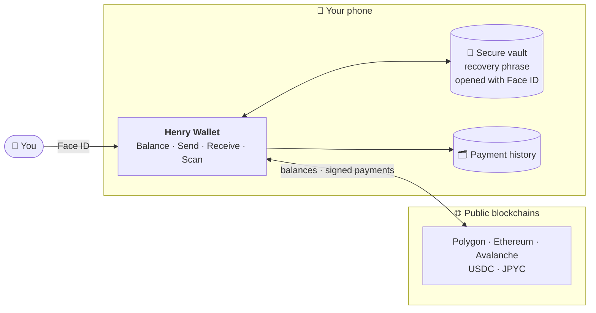
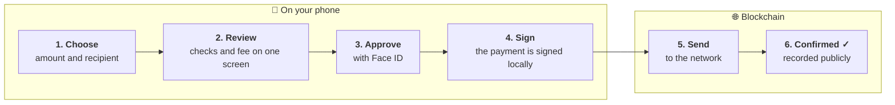

  

<h1 align="center">Henry Wallet</h1>

A self-custody wallet for stablecoins. Your keys stay on your phone. No account, no server, no middleman.

## What is Henry Wallet?

Henry Wallet is a small, personal wallet for holding and sending stablecoins such as **USDC** and **JPYC**. Everything happens on your own phone: the app creates your wallet, keeps its secret safe, and signs each payment only after you approve it with Face ID.

There is no Henry Wallet service behind the app. Nobody can see your balance, freeze your funds, or send a payment for you — and nobody can recover the wallet for you either, which is why the app asks you to write down a 12-word recovery phrase when you start.

## Highlights

- **Your keys, your money.** The recovery phrase is created on your phone and never leaves it.
- **Face ID on every payment.** Nothing is sent until you approve it.
- **See everything before you send.** Recipient, amount, network fee and safety checks sit on one screen, so you know what you are signing.
- **Made for sending across borders.** Stablecoins move in seconds for a small fee, whether you are paying at a shop or splitting a bill at a conference.
- **Scan and share with QR.** Show your address as a QR code, or scan someone else's to fill in the recipient.
- **Korean and English.** Switch languages from the top of the screen.

## What you can do

|                          |                                                                                     |
| ------------------------ | ----------------------------------------------------------------------------------- |
| **Create or import**     | Start a new wallet, or bring in one you already have with its 12-word phrase.       |
| **See your balance**     | USDC and JPYC at a glance, plus how many more transfers your fee balance covers.    |
| **Send**                 | Pick an amount and a recipient, review, approve with Face ID.                       |
| **Receive**              | Show your address and QR code, with a reminder to use the right network.            |
| **Follow your payments** | Watch each transfer go from waiting to confirmed, with a link to the public record. |

**Networks:** Polygon, Ethereum and Avalanche (plus their test networks for practice).
**Coins:** USDC and JPYC, with each network's own coin used to pay fees.

## How it fits together

Everything you do stays on your phone. The only thing that reaches the outside world is the finished, signed payment.

## Sending a payment

Each step before the network happens on your phone, and you can stop at any point before approving.

Before anything is signed, the app checks that the address is valid, that it is not a token's own address (a common way to lose funds), and that you have enough of the coin and enough for the fee.

## Keeping it simple

Henry Wallet does a few things and tries to do them clearly. It has one account per wallet and does not connect to websites or apps, swap coins, or run any server of its own.

## Disclaimer

This is an experimental personal wallet built for learning. It has not been audited. Use test networks or small amounts only, and do not keep significant funds in it.

## For developers

How it is built and what is planned: [`docs/PROJECT.md`](docs/PROJECT.md) (spec), [`docs/ROADMAP.md`](docs/ROADMAP.md) (progress), [`AGENTS.md`](AGENTS.md) (commands and working rules).
